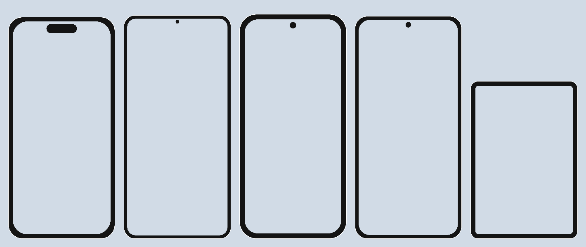

# Unity Device Simulator – Modern Devices (iPhone 16, Galaxy S25, Redmi Note 17, iPad Pro M4, Pixel 8)

**36 ready-to-use device definitions for the Unity Device Simulator**, covering the phones and tablets released from 2022 to 2026 that Unity's own `com.unity.device-simulator.devices` package does not include. Each device comes with its **screen resolution, DPI, safe area, camera cutout and a custom device frame overlay**, so you can test your UI layout, notch / Dynamic Island / punch-hole handling and `Screen.safeArea` logic on current hardware without leaving the Editor.

Drop the folder into your project and the new devices appear right away in the **Device Simulator** dropdown.



---

## Table of contents

- [Why this exists](#why-this-exists)
- [Installation](#installation)
- [Included devices](#included-devices)
- [How accurate are the values?](#how-accurate-are-the-values)
- [Important notes](#important-notes)
- [Adding your own device](#adding-your-own-device)
- [Folder structure](#folder-structure)
- [License and credits](#license-and-credits)

---

## Why this exists

The Unity Device Simulator ships with about 80 device definitions, but the newest ones are years old. In practice that means:

- **iPhone**: nothing newer than the iPhone 13 Pro, so there is no Dynamic Island
- **Samsung Galaxy**: stops at the S10 and the Note20 Ultra
- **Xiaomi / Redmi**: stops at the Redmi Note 7
- **iPad**: stops at the iPad Pro (2018) and the iPad Air (4th generation)
- **Google Pixel**: stops at the Pixel 5

If you build mobile apps or games in Unity, your users are on much newer screens: taller aspect ratios, punch-hole cameras and different safe areas. This collection fills that gap.

## Installation

1. Download or clone this repository.
2. Copy the whole folder, **including the `Overlays` subfolder**, anywhere under your project's `Assets/` folder, for example `Assets/Devices/`.
3. Open **Window → General → Device Simulator** and pick a device from the dropdown.

That's it: no code and no settings. Unity finds `.device` files in any folder under `Assets/`.

> **Tip:** move the folder from Unity's **Project window**, not from your file manager, so the `.meta` files stay with their assets. Always keep `Overlays/` next to the `.device` files, because each overlay path is relative to its definition file.

**Requirements:** Unity 2021.1 or newer (the Device Simulator is built in). Tested on **Unity 6 (6000.3)**.

## Included devices

### Apple iPhone

| Device | Resolution (px) | DPI | OS | Safe area top / bottom (portrait) | Also matches |
|---|---|---|---|---|---|
| Apple iPhone 15 | 1179 × 2556 | 460 | iOS 17 | 177 / 102 | iPhone 16 |
| Apple iPhone 15 Pro | 1179 × 2556 | 460 | iOS 17 | 177 / 102 | – |
| Apple iPhone 15 Pro Max | 1290 × 2796 | 460 | iOS 17 | 177 / 102 | iPhone 15 Plus, 16 Plus |
| Apple iPhone 16 Pro | 1206 × 2622 | 460 | iOS 18 | 186 / 102 | – |
| Apple iPhone 16 Pro Max | 1320 × 2868 | 460 | iOS 18 | 186 / 102 | – |

### Apple iPad

| Device | Resolution (px) | DPI | OS | Safe area top / bottom | Also matches |
|---|---|---|---|---|---|
| Apple iPad (10th generation) | 1640 × 2360 | 264 | iOS 16 | 48 / 40 | – |
| Apple iPad (A16) | 1640 × 2360 | 264 | iOS 18 | 48 / 40 | – |
| Apple iPad Air 11-inch (M3) | 1640 × 2360 | 264 | iOS 18 | 48 / 40 | iPad Air 11" (M2) |
| Apple iPad Air 13-inch (M3) | 2048 × 2732 | 264 | iOS 18 | 48 / 40 | iPad Air 13" (M2) |
| Apple iPad Pro 11-inch (M4) | 1668 × 2420 | 264 | iOS 17 | 48 / 40 | iPad Pro 11" (M5) |
| Apple iPad Pro 13-inch (M4) | 2064 × 2752 | 264 | iOS 17 | 48 / 40 | iPad Pro 13" (M5) |
| Apple iPad mini (A17 Pro) | 1488 × 2266 | 326 | iOS 18 | 48 / 40 | iPad mini (6th generation) |

### Samsung Galaxy

| Device | Resolution (px) | DPI | OS | Camera band (portrait) | Also matches |
|---|---|---|---|---|---|
| Samsung Galaxy S23 | 1080 × 2340 | 425 | Android 13 | 80 | – |
| Samsung Galaxy S23+ | 1080 × 2340 | 393 | Android 13 | 80 | – |
| Samsung Galaxy S23 Ultra | 1440 × 3088 | 500 | Android 13 | 89 | – |
| Samsung Galaxy S24 | 1080 × 2340 | 416 | Android 14 | 80 | – |
| Samsung Galaxy S24+ | 1440 × 3120 | 513 | Android 14 | 89 | – |
| Samsung Galaxy S24 Ultra | 1440 × 3120 | 505 | Android 14 | 89 | – |
| Samsung Galaxy S25 | 1080 × 2340 | 416 | Android 15 | 80 | – |
| Samsung Galaxy S25+ | 1440 × 3120 | 513 | Android 15 | 89 | – |
| Samsung Galaxy S25 Ultra | 1440 × 3120 | 498 | Android 15 | 89 | – |
| Samsung Galaxy S25 Edge | 1440 × 3120 | 513 | Android 15 | 89 | – |
| Samsung Galaxy A55 | 1080 × 2340 | 390 | Android 14 | 80 | Galaxy A35 |
| Samsung Galaxy A56 | 1080 × 2340 | 385 | Android 15 | 80 | Galaxy A36 |

### Xiaomi Redmi Note

| Device | Resolution (px) | DPI | OS | Camera band (portrait) | Also matches |
|---|---|---|---|---|---|
| Xiaomi Redmi Note 12 | 1080 × 2400 | 395 | Android 13 | 100 | – |
| Xiaomi Redmi Note 13 | 1080 × 2400 | 395 | Android 14 | 100 | – |
| Xiaomi Redmi Note 13 Pro | 1220 × 2712 | 446 | Android 14 | 113 | Redmi Note 13 Pro+ |
| Xiaomi Redmi Note 14 | 1080 × 2400 | 395 | Android 14 | 100 | – |
| Xiaomi Redmi Note 14 Pro | 1220 × 2712 | 446 | Android 14 | 113 | Redmi Note 14 Pro+ |
| Xiaomi Redmi Note 15 5G | 1080 × 2392 | 388 | Android 15 | 100 | – |
| Xiaomi Redmi Note 15 Pro 5G | 1280 × 2772 | 447 | Android 15 | 118 | – |
| Xiaomi Redmi Note 15 Pro+ 5G | 1280 × 2772 | 447 | Android 15 | 118 | – |
| Xiaomi Redmi Note 17 5G | 1080 × 2396 | 375 | Android 16 | 100 | – |
| Xiaomi Redmi Note 17 Pro 5G | 1280 × 2772 | 447 | Android 16 | 118 | – |
| Xiaomi Redmi Note 17 Pro Max 5G | 1280 × 2772 | 447 | Android 16 | 118 | – |

### Google Pixel

| Device | Resolution (px) | DPI | OS | Camera band (portrait) | Also matches |
|---|---|---|---|---|---|
| Google Pixel 8 | 1080 × 2400 | 428 | Android 14 | 132 | – |

**Total: 36 devices** (5 iPhone, 7 iPad, 12 Samsung Galaxy, 11 Xiaomi Redmi Note, 1 Google Pixel).

All values are in **physical pixels**. "Safe area top / bottom" is the inset that `Screen.safeArea` reports in portrait. "Camera band" is the strip at the top of the screen excluded from the safe area because of the punch-hole camera.

## How accurate are the values?

| Data | Source | Reliability |
|---|---|---|
| Resolution and DPI | Official manufacturer specifications | ✅ Exact |
| iPhone safe area (Dynamic Island, home indicator) | Apple Human Interface Guidelines, points × 3 | ✅ Exact |
| iPad safe area | Status bar (24 pt) + home indicator (20 pt), × 2 | ✅ Exact (status bar visible) |
| Android camera band and cutout | Calibrated on a measured device in Unity's package (Galaxy Note20 Ultra: 70 × 89 px) | ⚠️ Estimate |
| Screen corner radius and frame thickness | Typical values for each model | ⚠️ Approximate |
| `systemInfo` (GPU, RAM, model code) | Manufacturer specifications, base RAM tier | ℹ️ Indicative |

Layout, safe area and notch handling are reliable for iPhones and iPads. For Android, the camera band is a close estimate. If you need it pixel-perfect, log `Screen.safeArea` and `Screen.cutouts` on the real phone and update the `.device` file.

## Important notes

- **iPad safe area assumes the iOS status bar is visible** (`Player Settings → iOS → Status Bar Hidden` = off). If your app hides it, set the top inset to `0` in the iPad `.device` files.
- **Samsung QHD models run apps at FHD+ by default.** The Galaxy S2x+ / Ultra / Edge definitions use the native 1440 px width, as Unity's own package does. On real phones the default display setting is usually 1080 px wide, so also test with a 1080 px model.
- **iPhones don't support portrait upside down.** Face ID iPhones don't allow that orientation, so it is left out. iPads and Android devices support all four orientations.
- **Foldables are not included** (Galaxy Z Fold / Z Flip 5–7). They have two screens and need a dedicated multi-screen definition.
- **The overlays are stylized device frames**, not photos of the devices. They are drawn in the same flat style as Unity's built-in overlays: thin white rim, `#141414` bezel and a transparent screen. The Dynamic Island and punch-hole cameras are drawn opaque, so the Simulator blocks touches there just like the real device.
- **Overlays are imported with Read/Write enabled.** Unity needs this to mask input on the opaque parts of the frame. If you re-import them, keep that setting on.
- **These files are Editor-only.** They are never included in your player build, as long as you don't place them inside a `Resources` folder.

## Adding your own device

Every device is a plain JSON file with the `.device` extension. The quickest way to add a new one is to duplicate the closest existing definition and change:

| Field | What to change |
|---|---|
| `friendlyName` | Name shown in the Device Simulator dropdown |
| `screens[0].width` / `height` / `dpi` | Native resolution and pixel density |
| `screens[0].orientations[].safeArea` | Safe area for each orientation, in pixels, origin at the **bottom-left** |
| `screens[0].orientations[].cutouts` | Notch / punch-hole rectangles |
| `screens[0].presentation` | Overlay path, `borderSize`, `cornerRadius` |
| `systemInfo.operatingSystem` | **Must contain `iOS` or `Android`**, e.g. `"iOS 18.0"`, not `"iPadOS 18.0"` |

Overlay rules, verified against Unity's built-in overlays:

1. The overlay image must be exactly **screen size + border** on each side (e.g. 1206 × 2622 with a 55 px border → 1316 × 2732).
2. Transparent pixels are the screen; opaque pixels block input.
3. The Simulator draws the game view as a **square-cornered rectangle** under the frame. Keep the outer corner radius of the frame at or below **~3.2 × the border size**, otherwise the square screen corners poke out past the rounded frame.

Official reference: [Unity Manual – Add a device to the Device Simulator](https://docs.unity.com/en-us/engine/6000.3/manual/platform-specific/cross-platform-features/device-simulator/adding-a-device)

## Folder structure

```
Devices/
├── Apple iPhone 16 Pro.device          # device definitions (JSON)
├── Samsung Galaxy S25 Ultra.device
├── ...
├── Overlays/
│   ├── Apple iPhone 16 Pro_Overlay.png # device frame, Read/Write enabled
│   └── ...
└── Documentation~/                     # ignored by Unity (no import, no .meta)
    └── overlays-preview.png
```

## License and credits

- **Overlay images**: original artwork created for this collection.
- **Device definitions**: the JSON structure and the `systemInfo` / `graphicsDependentData` fields are derived from Unity's `com.unity.device-simulator.devices` package, licensed under the [Unity Companion License](https://unity3d.com/legal/licenses/unity_companion_license). Use them in Unity-based projects according to that license.
- **Specifications**: resolutions and pixel densities come from the manufacturers' published specifications.

*Apple, iPhone and iPad are trademarks of Apple Inc. Samsung and Galaxy are trademarks of Samsung Electronics Co., Ltd. Xiaomi and Redmi are trademarks of Xiaomi Inc. Google and Pixel are trademarks of Google LLC. This project is not affiliated with or endorsed by Unity Technologies or any device manufacturer.*

---

**Keywords:** Unity Device Simulator, Unity device definitions, `.device` files, Unity safe area, Dynamic Island Unity, notch, punch-hole camera, `Screen.safeArea`, `Screen.cutouts`, iPhone 16 Pro Unity, iPhone 15 Unity simulator, Galaxy S25 Unity, Galaxy S24 Ultra, Redmi Note 17, Redmi Note 15 Pro, iPad Pro M4, iPad Air M3, iPad mini A17 Pro, Pixel 8, mobile UI testing, responsive UI Unity, Unity 6.
